# Практична робота № 6. Комунікація в реальному часі засобами SSE та WebSockets

**Виконав:** Олійник Артем Сергійович  
**Курс:** IV  
**Група:** КН-43  
**Дисципліна:** Розробка застосувань клієнт-серверної архітектури  
**Викладач:** Олександр Олександрович Верещагін  
**Рік:** 2026

---

## Мета роботи

- Опанувати Server-Sent Events для однонапрямленої потокової доставки.
- Засвоїти протокол WebSocket і процедуру HTTP Upgrade.
- Реалізувати патерн Hub із реєстрацією клієнтів і broadcast.
- Розділити обробку з'єднання на `readPump` і `writePump`.
- Додати тематичні кімнати та Heartbeat Ping/Pong.

---

## Середовище

| Компонент | Версія |
|---|---|
| Операційна система | macOS 27.0.1 |
| Go | 1.27.1 |
| WebSocket | `github.com/gorilla/websocket` 1.5.3 |
| Клієнт WebSocket | `wscat` |
| Visual Studio Code | 1.145.2 |

Модуль проєкту: `github.com/ArtemOlyinik/client_server_Practichna_06`.

---

## Структура проєкту

```text
client_server_Practichna_06/
├── cmd/ssedemo/main.go          # потоковий SSE-клієнт
├── docs/                        # текст завдання
├── internal/hub/                # Hub, Client, readPump, writePump
├── internal/sse/                # SSE-обробник метрик
├── screenshots/                 # скріншоти роботи
├── web/index.html               # демонстраційна вебпанель
├── main.go                      # HTTP-сервер і маршрути
└── README.md
```

---

## Хід виконання

### Рівень 1. Однонапрямлений потік телеметрії через SSE

#### 1. Ініціалізація проєкту

```bash
go mod init github.com/ArtemOlyinik/client_server_Practichna_06
go get github.com/gorilla/websocket
```

Маршрут `GET /api/v1/metrics/stream` обслуговує `internal/sse.Handler`.

#### 2. Заголовки та `http.Flusher`

Обробник перевіряє, що `http.ResponseWriter` підтримує `http.Flusher`, і встановлює обов'язкові заголовки:

```go
w.Header().Set("Content-Type", "text/event-stream")
w.Header().Set("Cache-Control", "no-cache")
w.Header().Set("Connection", "keep-alive")
w.Header().Set("X-Accel-Buffering", "no")
```

Після кожного запису викликається `flusher.Flush()`, тому дані доходять до клієнта одразу, без закриття відповіді.

#### 3. Цикл трансляції метрик

Кожну секунду `time.NewTicker` зчитує:

- поточний час сервера у форматі RFC3339;
- кількість активних горутин через `runtime.NumGoroutine()`;
- виділену пам'ять через `runtime.MemStats`.

Метрики серіалізуються в JSON і надсилаються у форматі SSE:

```go
fmt.Fprintf(w, "data: %s\n\n", payload)
flusher.Flush()
```

#### 4. Контроль життєвого циклу

Обробник чекає на `<-r.Context().Done()`. Коли клієнт закриває вкладку або розриває з'єднання, таймер зупиняється, а горутина завершується без витоку.

#### 5. Перевірка потоку

Запускаємо сервер:

```bash
go run .
```

Потоковий клієнт `cmd/ssedemo` читає події з SSE:

```bash
go run ./cmd/ssedemo | head -n 14
```

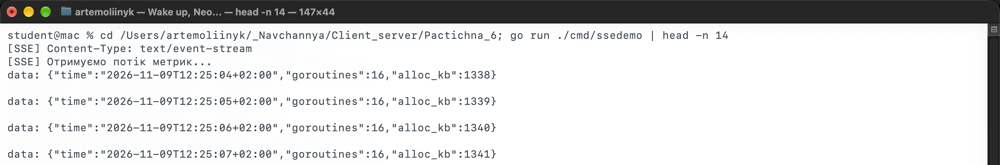

*Рис. 1. SSE-клієнт отримав `Content-Type: text/event-stream` і чотири події з часом, кількістю горутин та виділеною пам'яттю.*

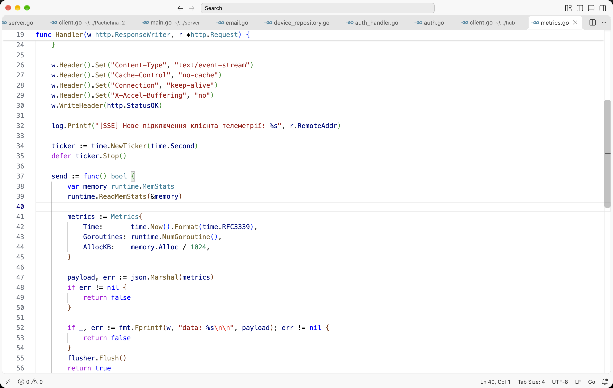

*Рис. 2. Фрагмент `internal/sse/metrics.go`: заголовки, `http.Flusher`, `runtime.MemStats` і `flusher.Flush()`.*

---

### Рівень 2. Повнодуплексний WebSocket-сервер і патерн Hub

#### 1. Upgrade з'єднання

`websocket.Upgrader` переводить HTTP-запит у WebSocket. `CheckOrigin` повертає `true`, щоб демонстраційна сторінка могла підключитися з будь-якого домену.

#### 2. Структура Hub

Hub зберігає мапу клієнтів і три канали:

```go
type Hub struct {
    clients    map[*Client]bool
    broadcast  chan Message
    register   chan *Client
    unregister chan *Client
    done       chan struct{}
}
```

`Run()` в нескінченному циклі `select` обробляє реєстрацію, видалення та broadcast. Розсилка виконується лише для клієнтів тієї самої кімнати.

#### 3. Клієнт і два цикли

Кожне з'єднання має буферований канал `send` місткістю 256 повідомлень. `readPump` читає кадри й передає їх у `hub.broadcast`, а `writePump` є єдиною горутиною, яка пише в сокет:

```go
case message := <-c.send:
    c.conn.WriteMessage(websocket.TextMessage, message)

case <-ticker.C:
    c.conn.WriteMessage(websocket.PingMessage, nil)
```

Це вирішує проблему небезпечного одночасного запису в `*websocket.Conn`.

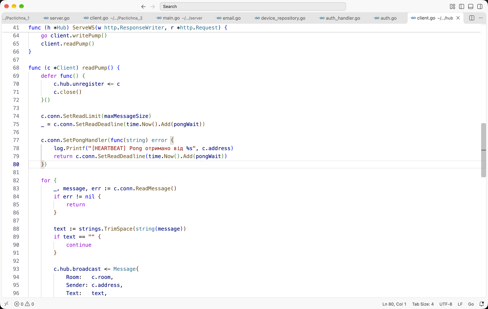

*Рис. 3. Фрагмент `client.go`: реєстрація, `SetPongHandler`, читання повідомлень і передача в Hub.*

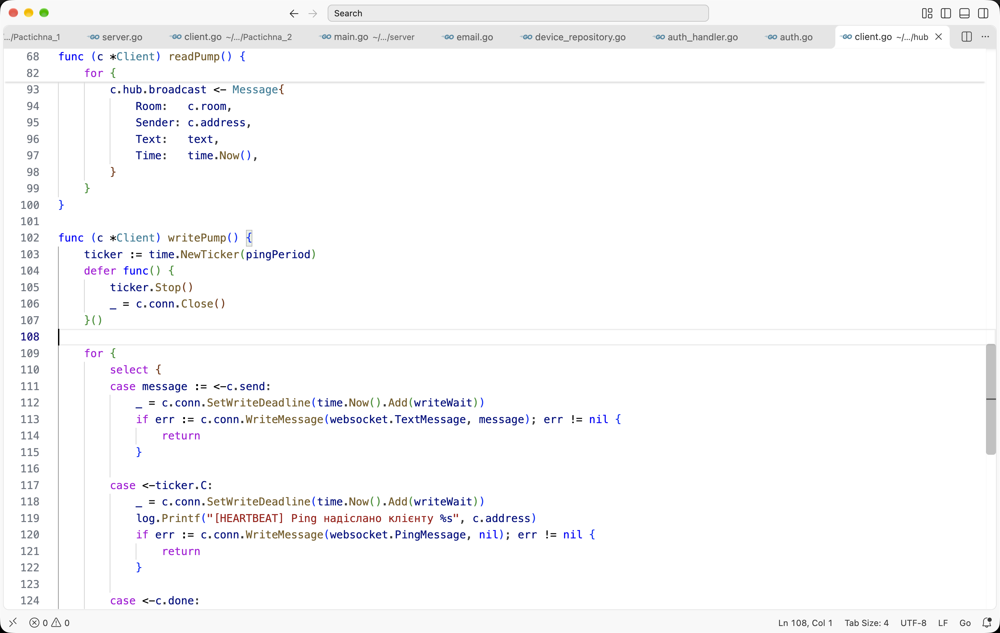

*Рис. 4. Фрагмент `writePump`: запис у сокет, тикер Heartbeat і відправка Ping-фрейму.*

#### 4. Перевірка в терміналі

Підключаємо двох клієнтів `wscat`:

```bash
wscat -c "ws://localhost:8080/api/v1/ws?room=alerts"
wscat -c "ws://localhost:8080/api/v1/ws?room=general"
```

У кімнаті `alerts` надсилаємо повідомлення. Воно з'являється в обох клієнтах цієї кімнати, а клієнт `general` залишається без повідомлень.

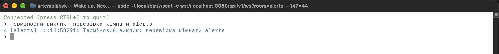

*Рис. 5. `wscat` у кімнаті `alerts`: відправлене повідомлення повернулося як `[alerts] ...`.*

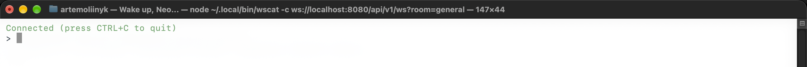

*Рис. 6. `wscat` у кімнаті `general`: з'єднання відкрите, але повідомлення з `alerts` не надходить.*

---

### Рівень 3. Кімнати, Heartbeat та вебклієнт

#### 1. Тематичні кімнати

Кімната береться з query-параметра `room`, типове значення - `general`. У структурі `Message` є поля `Room`, `Sender`, `Text`, `Time`, а `Format()` повертає рядок `[room] sender: text`. Hub фільтрує клієнтів за `client.room`, тому повідомлення не виходять за межі кімнати.

#### 2. Heartbeat Ping/Pong

`writePump` кожні 30 секунд надсилає Ping. `readPump` встановлює `SetPongHandler`, який продовжує `SetReadDeadline` на 60 секунд. Якщо Pong не надійшов, читання завершується помилкою, клієнт видаляється з Hub, а сокет закривається.

У консолі сервера видно цикли:

```text
[HEARTBEAT] Ping надіслано клієнту [::1]:53005
[HEARTBEAT] Pong отримано від [::1]:53005
```

#### 3. Демонстраційна вебпанель

`web/index.html` містить дві панелі:

- **Телеметрія SSE:** `new EventSource("/api/v1/metrics/stream")`, картки часу, горутин, пам'яті та кількості подій.
- **Пульт зв'язку:** вибір кімнати, `new WebSocket(...)`, журнал повідомлень і поле введення.

Сторінка відкривається за адресою `http://localhost:8080/`. Параметр `?room=alerts` автоматично вибирає кімнату.

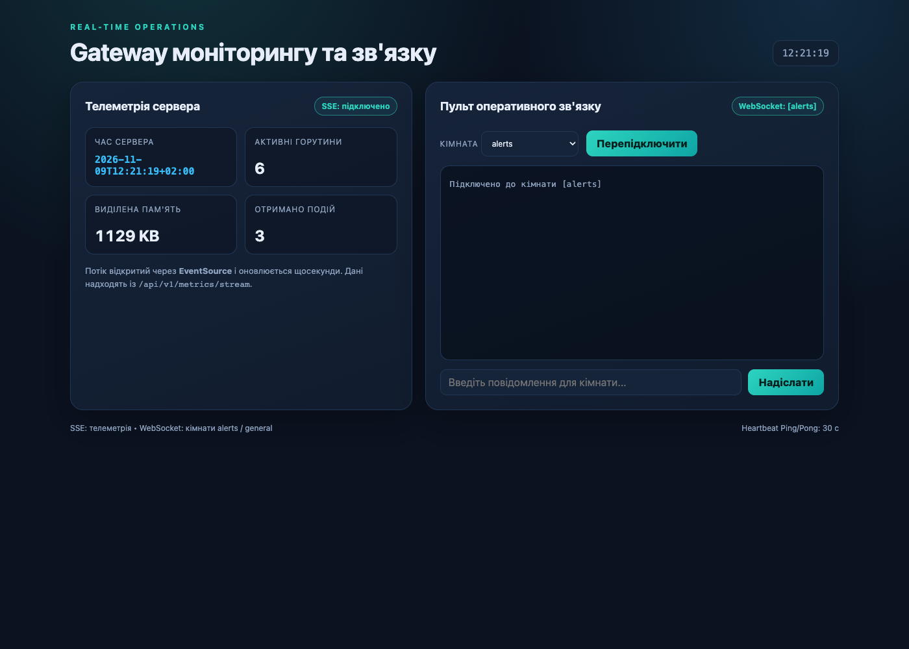

*Рис. 7. Вебпанель: SSE підключено, метрики оновлюються, WebSocket підключений до кімнати `alerts`.*

#### 4. Перевірка кімнат у браузері

Відкриваємо три вкладки: дві з `?room=alerts` і одну з `?room=general`. Надсилаємо повідомлення з першої вкладки `alerts`.

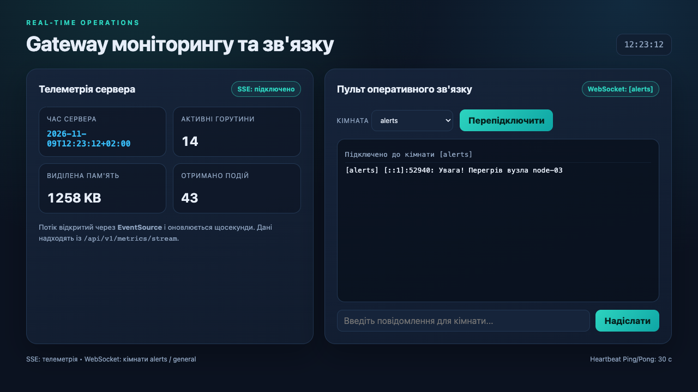

*Рис. 8. Друга вкладка `alerts` отримала `[alerts] ...: Увага! Перегрів вузла node-03`.*

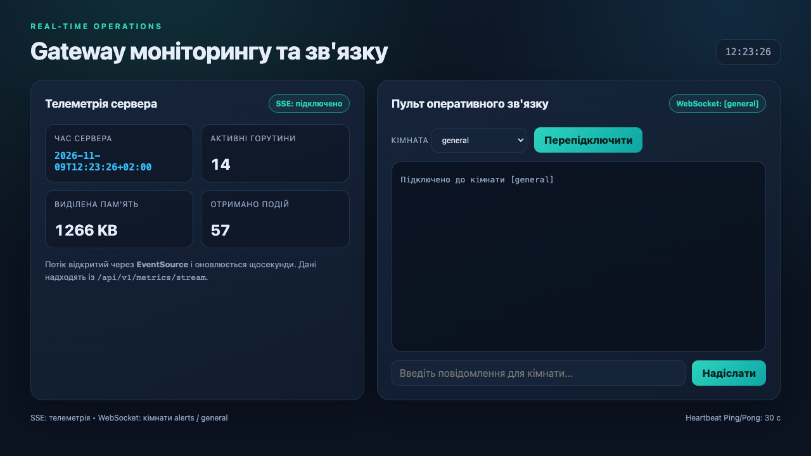

*Рис. 9. Вкладка `general` залишилася без повідомлення, хоча SSE-телеметрія працює.*

#### 5. Консоль сервера

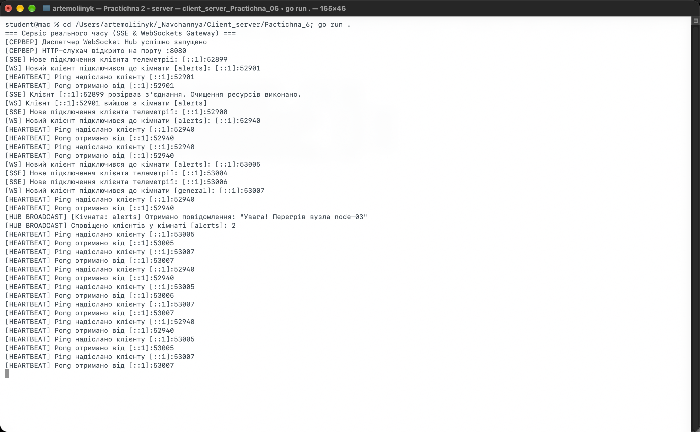

*Рис. 10. Консоль сервера: SSE-підключення, клієнти кімнат `alerts` і `general`, Ping/Pong, broadcast двом клієнтам кімнати `alerts`.*

#### 6. Тести та збірка

```bash
go vet ./...
go build ./...
go test -count=1 -race ./...
```

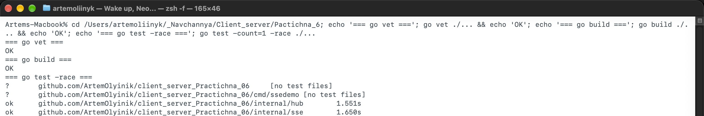

*Рис. 11. `go vet` і `go build` без помилок, тести `hub` та `sse` пройшли з детектором гонок.*

---

## Таблиця маршрутів

| Метод | Шлях | Призначення |
|---|---|---|
| `GET` | `/api/v1/metrics/stream` | SSE-потік метрик |
| `GET` | `/api/v1/ws?room=alerts` | WebSocket-кімната `alerts` |
| `GET` | `/api/v1/ws?room=general` | WebSocket-кімната `general` |
| `GET` | `/` | демонстраційна вебпанель |

---

## Інструкція запуску

```bash
# 1. Перейти в директорію проєкту
cd client_server_Practichna_06

# 2. Завантажити залежності
go mod download

# 3. Запустити сервер
go run .

# 4. Відкрити вебпанель
open http://localhost:8080/

# 5. Перевірити SSE у терміналі
go run ./cmd/ssedemo | head -n 14

# 6. Підключити WebSocket-клієнти
wscat -c "ws://localhost:8080/api/v1/ws?room=alerts"
wscat -c "ws://localhost:8080/api/v1/ws?room=general"
```

Для перевірки кімнат достатньо відкрити `http://localhost:8080/?room=alerts` і `http://localhost:8080/?room=general` у різних вкладках.

---

## Висновки

У роботі реалізовано два канали реального часу. SSE-обробник віддає телеметрію через `text/event-stream`, `http.Flusher` і `time.Ticker`, а після закриття вкладки коректно завершується за `r.Context().Done()`. WebSocket-сервер побудований за патерном Hub: кожен клієнт має окремий канал `send`, а `writePump` є єдиним писарем у сокет.

Кімнати `alerts` і `general` ізолюють повідомлення: клієнти `alerts` отримують повідомлення один одного, а `general` - ні. Heartbeat Ping/Pong виявляє завислі з'єднання та продовжує дедлайн читання. Вебпанель показує телеметрію і чат в одному інтерфейсі. Тести й статичний аналіз проходять без помилок.

---

## Контрольні питання

1. **Чим SSE відрізняється від WebSocket?**  
   SSE - однонапрямлений потік від сервера до клієнта через звичайний HTTP. WebSocket - повнодуплексний протокол із власними фреймами, який підтримує двосторонній обмін і бінарні дані. SSE простіший і має автоматичне перепідключення, WebSocket гнучкіший.

2. **Яку роль відіграє `http.Flusher`?**  
   Він примусово виштовхує буферизовані байти в мережу без закриття відповіді. Без `Flush()` клієнт може не побачити подію до заповнення буфера або завершення запиту.

3. **Що буде, якщо не відстежувати `r.Context().Done()`?**  
   Горутина обробника й таймер можуть залишитися живими після відключення клієнта. Вони продовжать писати в закрите з'єднання, витрачати пам'ять і створювати витік горутин.

4. **Опишіть WebSocket Upgrade Handshake.**  
   Клієнт надсилає HTTP GET із `Upgrade: websocket`, `Connection: Upgrade` і `Sec-WebSocket-Key`. Сервер відповідає `101 Switching Protocols` і додає `Sec-WebSocket-Accept`, після чого з'єднання переходить на WebSocket-фрейми.

5. **Чому `*websocket.Conn` небезпечний для одночасного запису?**  
   Запис у сокет не є атомарним: два потоки можуть переплутати фрейми або пошкодити заголовки. Hub використовує канал `send` і один `writePump`, тому всі записи йдуть послідовно.

6. **Навіщо розділяти `readPump` і `writePump`?**  
   Читання й запис можуть блокуватися незалежно. Дві горутини дозволяють одночасно приймати повідомлення, надсилати Ping і не блокувати одне одного. Це також спрощує обробку помилок і закриття.

7. **Як працює Heartbeat Ping/Pong?**  
   Сервер періодично надсилає Ping-фрейм. Клієнт відповідає Pong, а сервер продовжує `SetReadDeadline`. Якщо Pong не надійшов до дедлайну, з'єднання вважається завислим і закривається.

8. **Які переваги та обмеження має `EventSource`?**  
   Переваги: простий API, автоматичне перепідключення, працює через HTTP, текстовий формат. Обмеження: лише один напрямок, лише текст, немає бінарних даних і менше контролю над кадром порівняно з WebSocket.
